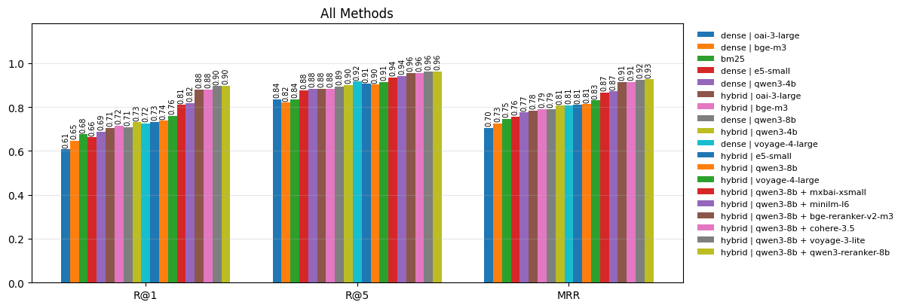

# RAG Retrieval Benchmark on SQuAD

I wanted to know how much the usual RAG retrieval tricks actually help, so I tested them on SQuAD v1.1: BM25, dense retrieval with five embedding models, hybrid search (BM25 + dense, merged with Reciprocal Rank Fusion) and three rerankers on top.

Work in progress, more to come.

## What I did

- Corpus: all 20,958 SQuAD paragraphs (train + validation), each one a document
- Task: for each question, find the paragraph it was written for
- Embeddings: Qwen3-Embedding-8B / 4B, Voyage-4-Large, OpenAI text-embedding-3-large, BGE-M3 (via OpenRouter, FAISS exact search)
- Rerankers: Qwen3-Reranker-8B, Voyage Rerank-3-Lite, Cohere Rerank 3.5, applied to the top 20 hybrid candidates
- Picked the setup on the train split, then ran it once on validation (10,500 questions)

## Results (validation)

| Pipeline | R@1 | R@5 | R@20 | MRR |
|---|---:|---:|---:|---:|
| BM25 | 0.70 | 0.87 | 0.93 | 0.77 |
| Dense (Qwen3-8B) | 0.74 | 0.93 | 0.97 | 0.82 |
| Hybrid (BM25 + Qwen3-8B) | 0.76 | 0.93 | 0.98 | 0.84 |
| **Hybrid + Voyage Rerank-3-Lite** | **0.91** | **0.98** | **0.98** | **0.94** |

- Reranking is the big one: Recall@1 goes from 0.76 to 0.91
- Hybrid beats dense alone for every embedding model, and helps the weaker ones most
- BM25 is surprisingly hard to beat on SQuAD; two of the five embedding models were worse than BM25 on their own
- The rerankers were all within about a point of each other, so I went with the lighter one

## Run it

Put your `OPENROUTER_API_KEY` in a `.env`, install the packages imported at the top of `main_nb.ipynb` and run the notebook. Embeddings and reranker responses are cached, so reruns are cheap. `make_plots.py` rebuilds the figures from `results.jsonl`.
